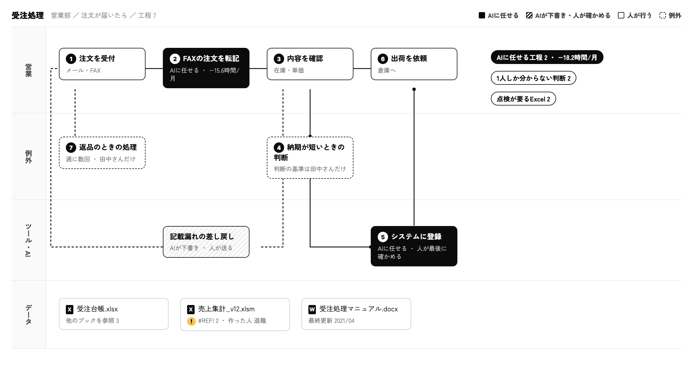

## 段階ごとにお渡しするもの

| 段階 | お渡しするもの | 中身 |
|---|---|---|
| 初期診断（14日） | 業務図 | 工程・担当・判断の基準・例外・AIの扱いを1枚に。製品の画面で管理し、御社の書式のPDFとExcelでも |
| 初期診断（14日） | 優先順位表 | 工程ごとの浮く時間と効果額、御社のAI環境で動くか、推奨の理由（Excel） |
| 初期診断（14日） | 効果の試算 | 件数 × 1件の時間 × 時間単価で出した、工程ごとの効果 |
| 構築（業務ごと） | AIエージェント | 御社の環境で動くAIエージェント。指示・判断の一覧・つなぐ先・止める条件 |
| 構築（業務ごと） | 検証結果と例外処理の工夫 | 過去の実例での出力の検証、止める条件、外れた件の直し方 |
| 運用（月額） | 検証結果と改善の記録 | 正しい出力の割合・見逃し・判定の推移、外れた件の原因と直したこと |
| 運用（月額） | 月次報告 | 任せた工程と今月の結果、翌月の提案と次の業務。30分の報告会でご説明します |

## 業務図

工程・担当・判断の基準・例外・AIの扱いを、1枚にまとめます。AIに任せる工程と、人が残す判断に印が付きます。

<figure class="figure"><figcaption>業務図（受注処理の例。会社・担当者・数字は説明用の例です）</figcaption></figure>

作業の箱を開くと、やり方、例外とやり方の違い、担当とAIとの分担、量と詰まり、確かめてほしいこと、根拠（回答者の名前を付けない答えの一文と人数、どの資料から分かったか）が並びます。図の読み方は[業務図の読み方](/companymap/docs/reading-the-map)にまとめています。

業務図は製品の画面で管理します。同じ内容を、文書番号・承認欄・改訂履歴のある御社の手順書の書式に合わせたPDFでもお渡しします。図を直すたびに版を上げ、前の版に戻すこともできます。

## 優先順位表と効果の試算

工程ごとに、浮く時間と効果額を件数 × 1件の時間 × 時間単価で出し、御社が契約中のAI環境（Copilot・Gemini など）で動くかと合わせて順位を付けます。工程ごとに、推奨の理由（効果・御社の環境・注意点）を書きます。理由には、当社がこれまでの支援で分析した約1,500タスクの傾向（似たタスクでAIが通った所・つまずいた所）も使います。

Excelでお渡しするので、社内のご説明にそのままお使いいただけます。

## AIエージェント

業務図の判断と例外を指示に組み込み、御社が契約中の環境の上に作ります。業務の形に合わせて、次の3つの型から選びます。

| 型 | 向く仕事 | 作る場所の例 |
|---|---|---|
| ワークフロー | 決まった手順を自動で回す（受付から登録の依頼まで など） | Power Automate、Workspace Flows、n8n・Dify |
| エージェント | 判断の一覧を持たせて任せる（FAXの注文の入力案 など） | Copilot Studio、Gemini の Gem、OpenAI・Claude の API |
| プロンプト | 担当者がすぐ使う指示（特値の確認の下書き など） | Microsoft 365 Copilot、Gemini、ChatGPT・Claude |

当社の画面に業務を移していただく必要はありません。AIの利用料は御社のご契約のままです。

## 検証と、止める条件

構築では、過去の実例をAIエージェントに処理させ、実際の結果と出力を比べます。9割以上を正しく出力できた工程だけを、止める条件を付けて任せます。読めない欄のように止める条件に当たる件は、人に回します。外れた件は、原因と直した点を記録します。

## 毎月の検証と月次報告

動き始めてからは、当月の実例で毎月出力を検証します。

- 記録するのは、正しい出力の割合、見逃し、判定の推移と、外れた件の原因・直したことです。
- 基準を下回った工程は止めて、人の作業に戻して直します。
- AIのモデルが新しくなったときも、同じ実例で検証し直します。
- 月次報告は1枚にまとめ、30分の報告会でご説明します。次に任せる業務も、ここで決めます。

## やめるとき

業務図・AIエージェント・記録は、すべて御社のものです。当社側のデータは30日で削除します。
