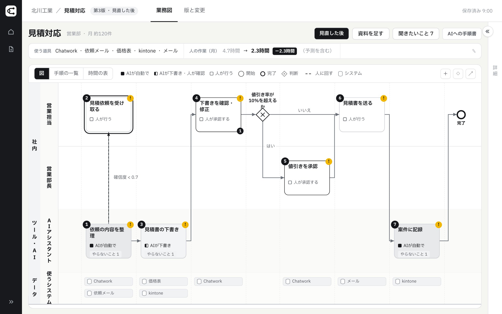

## ひとことで

ギョウムズAIは、業務図を起点に、御社が契約中の生成AI環境（Microsoft 365・Google Workspace など）でAIエージェントを作り、毎月の検証と改善まで当社が担うサービスです。14日間の初期診断でAIに任せる業務と効果を決め、1業務ずつ広げます。

業務図は工程・担当・判断の基準・例外を1枚にまとめた、AIへの指示書です。お預かりした手順書やExcelをAIが読んで下書きし、資料に残りにくい判断の理由だけを8つの質問で伺って仕上げます。AIエージェントを毎月検証して直すのは、TechWorkerの運用担当です。

<figure class="figure"><figcaption>ギョウムズAIの業務図の画面（説明用の例）</figcaption></figure>

## こんなときにお使いいただけます

2026年の国内調査では、生成AIを活用している企業で「活用すべき業務の範囲」を課題に挙げた割合が40.0%でした。AIを選ぶ前の「どの仕事を、どう変えるか」が決まらないところで、止まりやすくなっています。

担当交代・引き継ぎ
<b>来春、あの人が辞める。この部署の仕事を、誰も引き継げない。</b>期限は決まっているのに、業務の洗い出しが終わりません。担当者が休むと業務が回らない、と答えた人は52.3%。

Excelとマクロの属人化
<b>月末の集計が、前任者のマクロで止まる。</b>中身を誰も知らないExcelで、集計や請求が回っています。前任者の「謎マクロ・関数」に苦労した人は64.2%。

システム刷新での例外の漏れ
<b>システムを入れ替えたら、現場の「例外」で止まった。</b>要件定義に載っていたのは、手順書どおりの流れだけ。納期が短いときの確認は、稼働してから分かりました。

暗黙知の属人化
<b>手順書はあるのに、結局「あの人」に聞いている。</b>判断の基準が、ベテランの頭の中にあります。ノウハウが「一部のみ言語化」か「頭の中」と答えた人は62.2%。

出典：帝国データバンク「生成AIに関する企業の動向調査」2026年5月公表（有効回答10,312社。40.0%は生成AIを活用する3,560社の回答）／NTTデータ ビジネスブレインズ 営業事務経験3年以上の221人への調査 2026年8月公表（52.3%・64.2%）／ネオス「企業のAI活用に関する実態調査」2026年9月（就業者500名、62.2%）
{: .src}

## できること

<ol class="steps">
<li><b>見る：14日間の初期診断（一回）</b>お預かりした資料からAIが工程・判断・例外を下書きし、判断と例外に絞った8つの質問と確認会で確かめます。業務図と、AIに任せる業務の優先順位表、効果の試算をお渡しします。御社のご負担は3時間以内です。→ <a href="/companymap/docs/first-two-weeks">初期診断の14日</a></li>
<li><b>動かす：AIエージェントの構築（業務ごと）</b>業務図の判断と例外を指示に組み込み、御社の環境（Copilot Studio・Gemini など）でAIエージェントを作ります。過去の実例で出力を検証し、9割以上を正しく出力できた工程から、止める条件を付けて任せます。→ <a href="/companymap/docs/how-it-works">進め方と分担</a></li>
<li><b>回す：毎月の運用（月額）</b>当月の実例で出力を検証し、外れた件の原因を直します。基準を下回った工程は人に戻します。30分の報告会で月次報告をお渡しし、優先順位表の次の業務へ広げます。→ <a href="/companymap/docs/deliverables">お渡しするもの</a></li>
</ol>

## 業務図は、AIへの指示書です

業務図には、工程ごとに担当・判断の基準・例外・AIの扱いを書き込みます。構築では、この図の判断と例外をAIエージェントの指示に組み込みます。

業務図は製品の画面で管理し、同じ内容を御社の書式のPDFと、Excelの工程一覧でもお渡しします。動き始めたあとも、やり方が変わるたびに図を直し、見直す前と見直した後を版として残します。

## 向いているお客さま

- 生成AIを導入済みだが、本業の工程は変わっていない
- 「〇〇さんに聞かないと決まらない」仕事がある（返金・値引きの判断、月次の数字がずれた理由の説明、納期が短い注文の受け方など）
- 業務をAIに任せたいが、どこから手を付けるか決まっていない
- 手順書はあるが、現場のやり方と食い違っている

合わない使い方は[向いていない使い方](/companymap/docs/not-fit)にまとめています。
